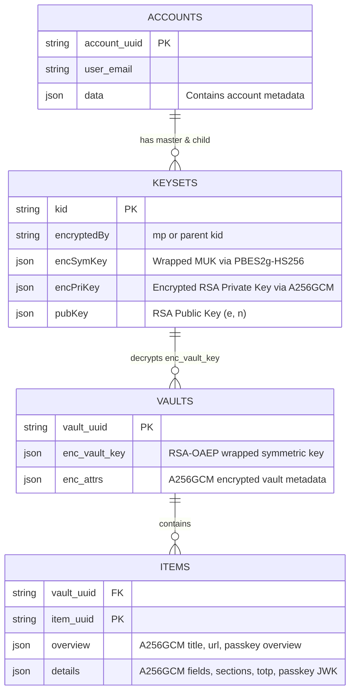
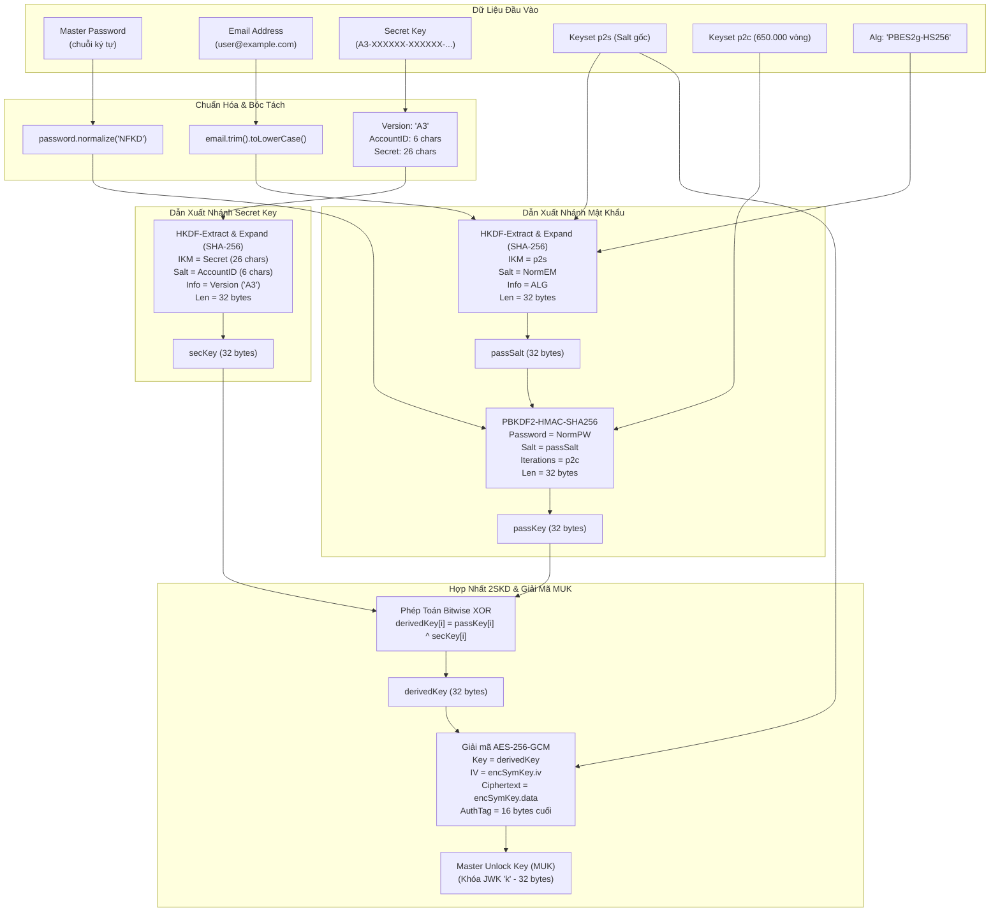

# Sổ Tay Kỹ Thuật: Giải Mã Pháp Y 1Password 8, Thuật Toán 2SKD & Khôi Phục Toàn Diện Passkey

> **Mã tài liệu**: `RUNBOOK-1PASS-2SKD-FORENSIC-01`  
> **Phân hệ**: `webmcp-vault-kit` / Security Engineering & Digital Forensics  
> **Phiên bản áp dụng**: 1Password 8 (macOS App & Group Container SQLite), Node.js $\ge$ 18 (Pure `node:crypto` & `node:sqlite`)  
> **Mục tiêu**: Hướng dẫn quy trình trích xuất, giải mã pháp y và chuyển đổi dữ liệu từ kho lưu trữ cục bộ của 1Password 8 khi các phương thức xuất file tiêu chuẩn (.csv, .1pux) bị khóa tính năng hoặc cố tình lược bỏ khóa bí mật Passkey (FIDO2 / WebAuthn).

---

## 1. Bản Chất Giới Hạn Của Các Định Dạng Xuất Chuẩn Của 1Password

Khi người dùng cần di chuyển dữ liệu (migration) khỏi 1Password hoặc khi tài khoản chuyển sang trạng thái bị đóng băng (Frozen / Billing Status `"F"`), các cơ chế xuất dữ liệu đồ họa (GUI Export) bộc lộ những khiếm khuyết nghiêm trọng mang tính chủ đích kiến trúc của nhà sản xuất:

### 1.1. Định dạng `.csv` (Comma-Separated Values)
- **Cắt bỏ hoàn toàn Passkey**: Cột `passkey` hoặc bị loại bỏ, hoặc tất cả giá trị đều là chuỗi rỗng `""`. 1Password không bao giờ xuất khóa bí mật Passkey ra file CSV.
- **Mất cấu trúc dữ liệu mở rộng**: CSV là định dạng phẳng (flat table), do đó toàn bộ Custom Sections, danh sách nhiều URL đồng thời (`URLs[]`), khóa SSH (`sshKey`), API Tokens, thẻ ghi chú định dạng Markdown đều bị xén cụt hoặc gộp thành một khối văn bản không thể phân giải tự động.
- **Lỗi ngắt dòng và vỡ cột (CSV Parsing Injection)**: Khi các trường ghi chú (`notesPlain`) hoặc trường dữ liệu tùy biến chứa dấu phẩy, dấu ngoặc kép (`"`) hoặc ký tự xuống dòng (`\n`, `\r\n`), các công cụ import tiêu chuẩn thường bị lệch cột (misalignment), gây mất mát dữ liệu tài khoản nghiêm trọng.

### 1.2. Định dạng `.1pux` (1Password Unencrypted Export)
- **Cấu trúc `.1pux`**: Thực chất là một file nén ZIP chứa hai tệp JSON chính:
  1. `export.attributes`: Chứa metadata phiên bản ứng dụng, ngày xuất, danh sách tài khoản.
  2. `export.data`: Chứa cây JSON toàn diện gồm `accounts[]`, `vaults[]`, và `items[]`.
- **Ưu điểm cục bộ**: Giữ được các trường `totp://` (`OTPAuth`) URI trong cấu trúc `sections[].fields[]`, giữ được cấu trúc category, tag, và toàn bộ lịch sử mật khẩu (`passwordHistory[]`).
- **Lỗ hổng "Cố tình triệt tiêu Passkey"**: Ngay cả trong `.1pux`, 1Password vẫn **cố tình cắt bỏ toàn bộ khóa bí mật (`privateKey`) và metadata của Passkey**. Trong `export.data`, các tài khoản đăng ký thuần bằng Passkey (như `grab.com`, `tiktok.com`, `github.com`) chỉ còn lại trường tên dịch vụ và tên người dùng trống rỗng hoặc bị khuyết thiếu, hoàn toàn không có khóa mật mã FIDO2.

### 1.3. Khám Phá Trọng Yếu: Mục "1Password Account" (Emergency Kit) Trong `.1pux`
Mặc dù 1Password chặn xuất Passkey, nhưng trong chính tệp `export.data` của file `.1pux`, 1Password lại xuất **toàn bộ dữ liệu của chính mục "1Password Account" (loại Emergency Kit)** dưới dạng **văn bản rõ (plaintext JSON)**!

Cụ thể, bên trong `accounts[].vaults[].items[]`, mục có tiêu đề `"1Password"` hoặc `"1Password Account"` chứa đầy đủ **bộ 3 chìa khóa gốc (Root Secrets)**:
1. **`email`**: Email đăng nhập 1Password (ví dụ: `user@example.com`).
2. **`password`**: Mật khẩu chính (Master Password) nằm trong trường `loginFields` với `designation: "password"`.
3. **`secretKey`**: Chuỗi khóa bí mật 128-bit định dạng `A3-XXXXXX-XXXXXX-XXXXX-XXXXX-XXXXX-XXXXX` nằm trong trường custom field `Secret Key` hoặc `notesPlain`.

> [!IMPORTANT]
> **Điểm đột phá pháp y**: Việc sở hữu file `.1pux` đồng nghĩa với việc chúng ta có trong tay đầy đủ 3 chìa khóa gốc để giải mã trực tiếp cơ sở dữ liệu SQLite cục bộ `1password.sqlite` trên máy tính, từ đó khôi phục lại **100% các Passkey nguyên bản** mà 1Password đã từ chối xuất ra file.

---

## 2. Vị Trí Lưu Trữ Và Kiến Trúc Cơ Sở Dữ Liệu 1Password 8 Trên macOS

### 2.1. Đường Dẫn Cơ Sở Dữ Liệu Cục Bộ
Trên macOS, 1Password 8 hoạt động dưới dạng App Sandbox và lưu trữ dữ liệu người dùng tại App Group Container:

```bash
~/Library/Group Containers/2BUA8C4S2C.com.1password/Library/Application Support/1Password/Data/1password.sqlite
```

> [!WARNING]
> **Quy tắc bắt buộc về chế độ SQLite WAL (Write-Ahead Logging)**:
> SQLite trong 1Password 8 luôn bật chế độ WAL. Mọi phiên ghi dữ liệu gần nhất, cập nhật passkey và thay đổi khóa đều nằm tại tệp log `-wal`.
> **KHI SAO CHÉP HOẶC KHÁM XÉT PHÁP Y, PHẢI LUÔN SAO CHÉP ĐỦ BỘ 3 TỆP**:
> 1. `1password.sqlite` (Cơ sở dữ liệu chính)
> 2. `1password.sqlite-wal` (Nhật ký giao dịch ghi trước)
> 3. `1password.sqlite-shm` (Bảng chỉ mục chia sẻ bộ nhớ)
> Nếu chỉ copy riêng tệp `.sqlite`, dữ liệu mở ra sẽ bị cũ, thiếu bản ghi mới hoặc lỗi liên kết bảng!

### 2.2. Các Bảng SQLite Then Chốt & Cấu Trúc Bản Ghi



#### Chi tiết các bảng:
1. **`accounts`**:
   - `account_uuid`: Định danh duy nhất của tài khoản.
   - `data`: Chứa thông tin tài khoản, địa chỉ email, mã định danh người dùng.
2. **`keysets`** (hoặc `objects_associated` với `type = 36`):
   - Lưu trữ các cặp khóa của tài khoản và các khoá kế thừa.
   - Keyset gốc có `encryptedBy = "mp"` (Master Password).
   - `encSymKey`: Chứa bản mã của Khóa Mở Khóa Chính (Master Unlock Key - `muk`), được bọc bởi thuật toán `PBES2g-HS256`. Chứa các tham số:
     - `alg`: `"PBES2g-HS256"`
     - `p2s`: Salt ngẫu nhiên được mã hóa Base64 / Base64URL.
     - `p2c`: Số vòng lặp PBKDF2 (1Password 8 thường dùng 650.000 vòng).
     - `iv`: Vector khởi tạo 12-byte (AES-GCM).
     - `data`: Bản mã khóa đối xứng `k` kèm 16-byte GCM authentication tag.
   - `encPriKey`: Bản mã của khóa bí mật bất đối xứng RSA Keyset, được mã hóa bằng khóa `muk` qua thuật toán `A256GCM`.
3. **`vaults`**:
   - `vault_uuid`: Định danh kho (Personal, Shared, v.v.).
   - `enc_vault_key`: Khóa đối xứng của Vault (Vault Symmetric Key), được mã hóa bằng khóa công khai RSA của Keyset qua thuật toán `RSA-OAEP` (SHA-1).
   - `enc_attrs`: Thuộc tính của kho (tên kho `name`, mô tả `desc`, icon) được mã hóa bằng Vault Symmetric Key qua `A256GCM`.
4. **`items`** (hoặc bảng/view `item_overviews` và `item_details`):
   - `overview`: Chứa tiêu đề (`title`), địa chỉ web (`url`, `URLs[]`), tài khoản vắn tắt (`ainfo`), nhãn (`tags`), và **Passkey Overview** (`passkey: { credentialId, rpId, userHandle }`). Mã hóa bằng Vault Key qua `A256GCM`.
   - `details`: Chứa danh sách trường đăng nhập (`fields[]`), các custom sections chứa TOTP URI, ghi chú (`notesPlain`), và **Passkey Details** (`passkey: { type: "webauthn", createdAt, privateKey, userHandle }`). Mã hóa bằng Vault Key qua `A256GCM`.

---

## 3. Đặc Tả Toán Học & Mật Mã 2SKD (Two-Secret Key Derivation / `PBES2g-HS256`)

Thuật toán dẫn xuất khóa 2SKD là trái tim bảo mật của 1Password. Thuật toán này ngăn chặn triệt để tấn công vét cạn (brute-force) ngay cả khi kẻ tấn công đánh cắp được cơ sở dữ liệu `1password.sqlite` và có siêu máy tính, bởi vì thuật toán đòi hỏi đồng thời 2 bí mật độc lập: **Mật khẩu người dùng** (Master Password - biến đổi theo trí nhớ) và **Secret Key** (128-bit entropy cao do hệ thống sinh ra).

### 3.1. Sơ Đồ Pipeline Dẫn Xuất Khóa 2SKD



### 3.2. Thuật Toán Chi Tiết Bằng Node.js `node:crypto`

Toàn bộ quy trình giải mã được hiện thực bằng chuẩn ECMAScript thuần sử dụng module tích hợp sẵn `node:crypto` không phụ thuộc bất kỳ thư viện bên ngoài nào:

```javascript
import crypto from 'node:crypto';

// Hàm chuẩn hóa chuỗi Base64 hoặc Base64URL về Buffer
function b64u(str) {
  if (!str) return Buffer.alloc(0);
  const clean = str.trim();
  const isUrl = clean.includes('-') || clean.includes('_');
  return Buffer.from(clean, isUrl ? 'base64url' : 'base64');
}

// Hàm giải mã đối xứng AES-256-GCM
function decryptA256GCM(keyBuf, encObj) {
  const iv = b64u(encObj.iv);
  const full = b64u(encObj.data);
  if (full.length < 16) throw new Error('Ciphertext quá ngắn, không đủ 16 byte AuthTag');
  
  const authTag = full.subarray(full.length - 16);
  const ciphertext = full.subarray(0, full.length - 16);
  
  const decipher = crypto.createDecipheriv('aes-256-gcm', keyBuf, iv);
  decipher.setAuthTag(authTag);
  return Buffer.concat([decipher.update(ciphertext), decipher.final()]).toString('utf8');
}

// Hàm giải mã bất đối xứng RSA-OAEP SHA-1
function decryptRSAOAEP(privKeyObj, encObj) {
  return crypto.privateDecrypt(
    { key: privKeyObj, padding: crypto.constants.RSA_PKCS1_OAEP_PADDING, oaepHash: 'sha1' },
    b64u(encObj.data)
  ).toString('utf8');
}
```

#### Bước 3.2.1: Chuẩn hóa dữ liệu đầu vào và phân tách Secret Key
```javascript
const rawEmail = "user@example.com";
const rawPassword = "@YourMasterPassword";
const rawSecretKey = "A3-XXXXXX-XXXXXX-XXXXX-XXXXX-XXXXX-XXXXX";

// 1. Chuẩn hóa Email và Password
const email = rawEmail.trim().toLowerCase();
const password = rawPassword.trim().normalize('NFKD');

// 2. Phân tách Secret Key (loại bỏ gạch ngang nếu có)
const skClean = rawSecretKey.trim().replace(/-/g, '');
const version = skClean.slice(0, 2);      // "A3"
const accountId = skClean.slice(2, 8);    // 6 ký tự Account ID
const secret = skClean.slice(8);          // 26 ký tự Secret Entropy
```

#### Bước 3.2.2: Tính toán Salt 1 và dẫn xuất PassKey qua PBKDF2
```javascript
// Lấy các tham số từ bản ghi mpKeyset.encSymKey trong bảng keysets
const p2s = b64u(mpKeyset.encSymKey.p2s);
const p2c = mpKeyset.encSymKey.p2c; // ví dụ: 650000
const alg = mpKeyset.encSymKey.alg; // "PBES2g-HS256"

// Tính passSalt = HKDF(IKM=p2s, Salt=email, Info=alg, Length=32)
const passSalt = Buffer.from(
  crypto.hkdfSync('sha256', p2s, Buffer.from(email, 'utf8'), Buffer.from(alg, 'utf8'), 32)
);

// Dẫn xuất passKey qua PBKDF2 với số vòng lặp p2c
const passKey = crypto.pbkdf2Sync(Buffer.from(password, 'utf8'), passSalt, p2c, 32, 'sha256');
```

#### Bước 3.2.3: Tính toán Secret Key Hash qua HKDF
```javascript
// Tính secKey = HKDF(IKM=secret, Salt=accountId, Info=version, Length=32)
const secKey = Buffer.from(
  crypto.hkdfSync('sha256', Buffer.from(secret, 'utf8'), Buffer.from(accountId, 'utf8'), Buffer.from(version, 'utf8'), 32)
);
```

#### Bước 3.2.4: Phép biến đổi XOR và giải mã Master Unlock Key (MUK)
```javascript
// Kết hợp 2 bí mật bằng phép XOR từng byte
const derivedKey = Buffer.alloc(32);
for (let i = 0; i < 32; i++) {
  derivedKey[i] = passKey[i] ^ secKey[i];
}

// Giải mã encSymKey để nhận Master Unlock Key dạng JWK
const mukJwkJson = JSON.parse(decryptA256GCM(derivedKey, mpKeyset.encSymKey));
const muk = b64u(mukJwkJson.k); // Master Unlock Key đối xứng 32 byte
```

#### Bước 3.2.5: Giải mã chuỗi Keyset RSA và Vault Keys
```javascript
// 1. Dùng MUK giải mã khóa riêng RSA của Master Keyset
const mpPrivJwk = JSON.parse(decryptA256GCM(muk, mpKeyset.encPriKey));
const mpPrivKey = crypto.createPrivateKey({ key: mpPrivJwk, format: 'jwk' });

// 2. Duyệt cây Keyset giải mã các keyset phụ (nếu có)
// Mỗi keyset con có encSymKey được bọc bởi RSA của keyset cha qua RSA-OAEP
// ...

// 3. Giải mã Vault Symmetric Key từ bảng vaults
// vData.enc_vault_key được bọc bởi RSA Private Key tương ứng
const vKeyJwk = JSON.parse(decryptRSAOAEP(mpPrivKey, vData.enc_vault_key));
const vKeyBuf = b64u(vKeyJwk.k); // Khóa đối xứng của Vault

// 4. Giải mã thông tin thuộc tính của Vault (Tên Vault, mô tả)
const vaultAttrs = JSON.parse(decryptA256GCM(vKeyBuf, vData.enc_attrs));
console.log(`Vault Name: ${vaultAttrs.name}`);

// 5. Giải mã các Item trong kho
const itemOverview = JSON.parse(decryptA256GCM(vKeyBuf, itemRow.overview));
const itemDetails = JSON.parse(decryptA256GCM(vKeyBuf, itemRow.details));
```

---

## 4. Bóc Tách Khóa Bí Mật Passkey & Chuẩn Hóa Chữ Ký FIDO2/WebAuthn

### 4.1. Cấu Trúc Khóa Bí Mật Passkey Trong 1Password
Trong bản ghi `itemDetails.passkey`, 1Password lưu trữ khóa bí mật dưới dạng một chuỗi **Base64URL của chuỗi JSON UTF-8 JWK (JSON Web Key)** đường cong elliptic P-256 (`secp256r1` / `prime256v1`):

```json
{
  "type": "webauthn",
  "createdAt": 1748472117,
  "userHandle": "R09PR0xFX0FDQ09VTlQ6MTA1MzIzNTcyMTUzODk0Njk3Mjcz",
  "privateKey": "eyJrdHkiOiJFQyIsImNydiI6IlAtMjU2IiwiZCI6IkNBOFhN...IiwiYWxnIjoiRVMyNTYifQ"
}
```

Khi giải mã Base64URL trường `privateKey`, ta nhận được đối tượng JWK chuẩn:
```json
{
  "kty": "EC",
  "crv": "P-256",
  "d": "CA8XM7uo2GEmpgmQHKF244wtHyz1v8v30X-M-jSh8QQ",
  "x": "CeNGqTvkjfXrzyVYZKSBzo0vvBQr-VSuJFDPEjrvroM",
  "y": "RTyYzpJSjj2En7vTtrY1PmzvzQyOaGQ66Ir0MhOmNqE",
  "alg": "ES256"
}
```
Trong đó:
- `crv`: Loại đường cong Elliptic (`P-256`).
- `d`: Scalar khóa riêng tư 32 bytes (Private Key).
- `x`, `y`: Tọa độ điểm công khai trên đường cong Elliptic (Public Key).
- `alg`: Thuật toán chữ ký (`ES256` = ECDSA sử dụng SHA-256).

### 4.2. Chuyển Đổi JWK Sang PKCS#8 DER Base64 Cho Chromium CDP & WebMCP Vault
Chromium DevTools Protocol (CDP API `WebAuthn.addCredential`) và hệ thống quản lý Vault tự động hóa của WebMCP yêu cầu khóa bí mật Passkey ở định dạng **PKCS#8 ASN.1 DER (mã hóa Base64)**:

```javascript
// Chuyển đổi từ JWK sang PKCS#8 DER Base64
function jwkToPkcs8Base64(jwk) {
  const keyObj = crypto.createPrivateKey({ key: jwk, format: 'jwk' });
  return keyObj.export({ type: 'pkcs8', format: 'der' }).toString('base64');
}

// Chuyển đổi ngược lại từ PKCS#8 DER Base64 sang JWK
function pkcs8Base64ToJwk(pkcs8Base64) {
  const derBuf = Buffer.from(pkcs8Base64, 'base64');
  const keyObj = crypto.createPrivateKey({ key: derBuf, format: 'der', type: 'pkcs8' });
  return keyObj.export({ format: 'jwk' });
}
```

### 4.3. Cờ Xác Thực WebAuthn: Tại Sao Cờ `0x1d` (`BE=1`, `BS=1`) Là Bắt Buộc?

Khi một Passkey được tạo bởi 1Password, đây là một **Synced Passkey** (khóa đồng bộ đa thiết bị lưu trên đám mây của 1Password).

Trong chuẩn W3C WebAuthn Level 3 (§6.1) và FIDO CTAP2, cấu trúc `authenticatorData` (37 bytes tối thiểu) chứa 1 byte cờ (`flags` tại offset byte thứ 32):

| Bit | Tên Cờ | Giá Trị Hex | Ý Nghĩa Trong Xác Thực Passkey |
| :--- | :--- | :--- | :--- |
| **Bit 0** | **UP** (User Present) | `0x01` | Người dùng có mặt tương tác vật lý. |
| **Bit 2** | **UV** (User Verified) | `0x04` | Người dùng đã được xác thực sinh trắc học/PIN. |
| **Bit 3** | **BE** (Backup Eligibility) | `0x08` | Khóa có khả năng sao lưu và đồng bộ đa thiết bị. |
| **Bit 4** | **BS** (Backup State) | `0x10` | Khóa hiện đang ở trạng thái đã được sao lưu. |

> [!IMPORTANT]
> **Giá trị cờ bắt buộc**:  
> $$\text{Flags} = \text{UP} \mid \text{UV} \mid \text{BE} \mid \text{BS} = 0x01 \mid 0x04 \mid 0x08 \mid 0x10 = \mathbf{0x1d} \quad (29 \text{ trong hệ thập phân})$$
> 
> **Tại sao bắt buộc?**  
> Khi người dùng đăng ký Passkey với Google, GitHub, Microsoft, Apple, hoặc PayPal thông qua 1Password, Relying Party (RP Server) đã ghi nhận vào cơ sở dữ liệu xác thực của họ rằng khóa này có thuộc tính `backupEligibility: true` và `backupState: true`.  
> Nếu khi ký xác thực (Assertion), authenticator trả về cờ mặc định thô sơ `0x05` (`UP=1, UV=1` nhưng `BE=0, BS=0` như các khóa bảo mật phần cứng YubiKey vật lý), máy chủ của Google/GitHub sẽ phát hiện sự mâu thuẫn trạng thái sao lưu so với lúc đăng ký, kích hoạt cảnh báo bất thường hoặc từ chối phiên đăng nhập!

---

## 5. Tổ Chức Danh Mục Vault Chuẩn Hóa & Bóc Tách Mã TOTP

### 5.1. Cây Phân Cấp Thư Mục Vault (Taxonomy) Đề Xuất
Sau khi khôi phục hàng trăm tài khoản từ 1Password, việc gom toàn bộ vào một kho duy nhất sẽ gây tắc nghẽn giao diện và khó phân quyền cho các AI Agent. Quy chuẩn cấu trúc kho lồng nhau (Nested Vault Taxonomy) áp dụng trong WebMCP:

```
WEBMCP VAULT ROOT
├── SOCIAL/
│   ├── SOCIAL/FB (Facebook Profile & Page Accounts)
│   ├── SOCIAL/TIKTOK (Kênh TikTok, Creator Accounts)
│   ├── SOCIAL/YOUTUBE (Kênh YouTube Brand & Studio)
│   ├── SOCIAL/X (X / Twitter Profiles)
│   ├── SOCIAL/TELEGRAM
│   └── SOCIAL/ZALO
├── EMAIL/
│   ├── EMAIL/GOOGLE (Gmail cá nhân & Workspace doanh nghiệp)
│   ├── EMAIL/MICROSOFT (Outlook, Live, Hotmail, Office 365)
│   ├── EMAIL/PROTON (ProtonMail bảo mật cao)
│   └── EMAIL/DOMAIN (Email server riêng, IMAP/SMTP credentials)
├── FINANCE/
│   ├── FINANCE/BANKING (Tài khoản ngân hàng số, VNeID, SmartCA)
│   ├── FINANCE/CRYPTO (Sàn Binance, OKX, Ví Web3)
│   └── FINANCE/PAYMENT (PayPal, Stripe, VNPAY)
├── WORK/
│   ├── WORK/COMPANY (Cổng thông tin nội bộ, CRM, Jira)
│   └── WORK/CLIENTS (Tài khoản đối tác bàn giao)
├── SHOPPING (Thương mại điện tử: Shopee, Lazada, Amazon, Tiki)
├── DEV/
│   ├── DEV/GITHUB (Tài khoản GitHub, Personal Access Tokens)
│   ├── DEV/API_TOKEN (OpenAI, Anthropic, Cloudflare, DeepSeek)
│   ├── DEV/HOMELAB (Server nội bộ, Proxmox, SSH Keys, Traefik)
│   └── DEV/AI (Tài khoản dịch vụ AI tổng hợp)
└── APPLE (Kho riêng biệt dành cho Apple ID, iCloud, App Store)
```

### 5.2. Chuẩn Hóa Mã Bí Mật TOTP Từ `otpauth://`
Trong 1Password 8, trường TOTP được lưu trữ tại `details.sections[].fields[]` dưới dạng chuỗi `otpauth://totp/...`.

Quy trình chuẩn hóa tự động:
1. Nhận diện trường: Khớp `id.startsWith('TOTP_')`, `name.startsWith('TOTP_')`, hoặc `title` chứa cụm từ `"one-time password"`.
2. Trích xuất URL query: Phân giải URI `new URL(valStr)` và lấy tham số `secret`.
3. Làm sạch Base32: Loại bỏ khoảng trắng thừa, chuyển thành chữ in hoa `[A-Z2-7]`.
4. Lưu vào trường `otpSecret` của WebMCP Item để bộ sinh mã 6 chữ số tự động kích hoạt mỗi 30 giây.

```javascript
function extractTotpSecret(rawUriOrSecret) {
  if (!rawUriOrSecret) return null;
  const str = rawUriOrSecret.trim();
  if (str.startsWith('otpauth://totp/')) {
    try {
      const url = new URL(str);
      const s = url.searchParams.get('secret');
      return s ? s.replace(/\s+/g, '').toUpperCase() : null;
    } catch {
      return null;
    }
  }
  // Nếu là chuỗi Base32 trực tiếp
  const clean = str.replace(/\s+/g, '').toUpperCase();
  if (/^[A-Z2-7=]{16,64}$/.test(clean)) return clean;
  return null;
}
```

---

## 6. Hướng Dẫn Vận Hành CLI Giải Mã Pháp Y: `recover-1password-sqlite.mjs`

Công cụ dòng lệnh tái sử dụng đã được biên soạn và tích hợp sẵn tại:
```bash
/Users/ttcenter/Desktop/VIBE_CODE/webmcp-automation-kit/packages/webmcp-vault-kit/scripts/recover-1password-sqlite.mjs
```

### 6.1. Trường Hợp 1: Tự Động Khôi Phục Từ Tệp `.1pux`
Khi có tệp xuất `.1pux`, bạn không cần gõ mật khẩu hay Secret Key, script sẽ tự động tìm mục Emergency Kit bên trong để lấy bộ 3 chìa khóa rồi mở `1password.sqlite`:

```bash
node /Users/ttcenter/Desktop/VIBE_CODE/webmcp-automation-kit/packages/webmcp-vault-kit/scripts/recover-1password-sqlite.mjs \
  --from-1pux /tmp/export.1pux \
  --format webmcp \
  --out /Users/ttcenter/.webmcp/vault/recovered-1password.json \
  --verbose
```

### 6.2. Trường Hợp 2: Chỉ Định Trực Tiếp Thông Tin Đăng Nhập
Khi chỉ có tệp SQLite và bạn nhớ thông tin đăng nhập:

```bash
node /Users/ttcenter/Desktop/VIBE_CODE/webmcp-automation-kit/packages/webmcp-vault-kit/scripts/recover-1password-sqlite.mjs \
  --db "/path/to/1password.sqlite" \
  --email "user@example.com" \
  --password "@YourMasterPassword" \
  --secret-key "A3-XXXXXX-XXXXXX-XXXXX-XXXXX-XXXXX-XXXXX" \
  --format full \
  --out ./recovered-vault-archive.json
```

### 6.3. Trường Hợp 3: Chỉ Xuất Riêng Các Tài Khoản Chứa Passkey
Để phục vụ việc kiểm thử xác thực Passkey hoặc nạp vào CDP Virtual Authenticator:

```bash
node /Users/ttcenter/Desktop/VIBE_CODE/webmcp-automation-kit/packages/webmcp-vault-kit/scripts/recover-1password-sqlite.mjs \
  --from-1pux /tmp/export.1pux \
  --format passkeys-only \
  --out ./recovered-passkeys.json
```

---

## 7. Nguyên Tắc An Toàn & Vệ Sinh Môi Trường Pháp Y (Forensic Hygiene)

1. **Phân Quyền Tệp Nghiêm Ngặt (`0600`)**:
   Mọi tệp kết quả giải mã JSON sinh ra từ script đều tự động được áp dụng cờ phân quyền `chmod 0600` (`-rw-------`), chỉ cho phép duy nhất người dùng hiện tại có quyền đọc/ghi. Tuyệt đối không cho phép quyền đọc của nhóm (`group`) hoặc người khác (`other`).
2. **Không Lưu Vết Bí Mật (Zero Secret Leakage)**:
   - CẤM hardcode mật khẩu thật, Secret Key thật vào file tài liệu này hoặc mã nguồn commit lên Git.
   - Các biến trong log debug hiển thị Secret Key phải được cắt ngắn (`masking` dạng `A3-XXXXXX-***`).
3. **Tiêu Hủy Tệp Tạm Ngay Sau Khi Nạp Vào Vault**:
   Sau khi nạp toàn bộ Passkey và tài khoản vào WebMCP Vault chính thức (`~/.webmcp/vault/credentials.enc.json`), người vận hành phải chạy lệnh xóa sạch (secure wipe) toàn bộ các tệp trung gian:
   ```bash
   rm -rf /tmp/1pass_* /tmp/export.1pux /tmp/recovered_passkeys.json
   ```
4. **Bảo Tồn Bất Biến Kiểm Thử (Regression Prevention)**:
   Mọi thay đổi tiếp theo đối với module `lib/vault/passkey.js` hoặc API Vault phải chạy qua bộ kiểm thử `tests/passkey.test.js` để đảm bảo 100% Passkey được giải mã đều có thể tạo chữ ký Assertion hợp lệ đối với máy chủ RP thực tế.
