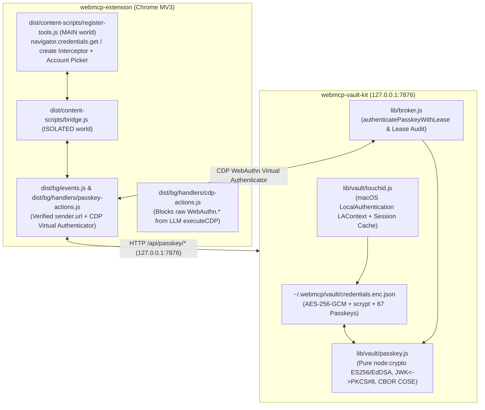

# Unified Proposal & Action Plan: WebMCP Passkey Vault, Touch ID Unlock, Extension & Agent Passkey Provider

> **Ngày lập**: 2026-10-17
> **Quy trình**: Multi-AI Research & Deliberation (`Muse Preset GLM 5.3 Flash`, `Claude Opus 5.5`, `Gemini 4 Argon`) + `/ponytail` Architecture Gate
> **Mục tiêu**: Nâng cấp `webmcp-vault-kit` và `webmcp-browser-kit` (`webmcp-extension`) thành hệ thống quản lý & xác thực **Passkey (FIDO2 / WebAuthn / CXF 1.0)** chuẩn công nghiệp, tích hợp **Touch ID Unlock**, phục vụ đồng thời **Extension trình duyệt hàng ngày** và **AI Agent tự động hóa**, kèm nạp toàn bộ **67 Passkeys** khôi phục từ `1password.sqlite`.

---

## 1. Kiến Trúc Tổng Thể (Best-in-Class `/ponytail` Design)

---

## 2. Danh Sách Tác Vụ Triển Khai (Execution Checklist)

### Phase 1: Core Passkey Crypto Engine & Data Model (`webmcp-vault-kit`)
- [x] **1.1. Tạo `lib/vault/passkey.js` (Pure `node:crypto`, 0 external deps)**:
  - Chuyển đổi hai chiều `jwkToPkcs8Base64(jwk)` và `pkcs8Base64ToJwk(pkcs8Base64)`.
  - Hàm kiểm tra `isValidRpIdForHost(rpId, callerHost)` một chiều nghiêm ngặt theo chuẩn W3C WebAuthn (§5.1.3).
  - Hàm `signPasskeyAssertion({ passkey, rpId, origin, challenge, clientDataJSON, flags })` tạo `authenticatorData` (37 bytes với cờ mặc định `0x1d = UP|UV|BE|BS`), `clientDataJSON`, và chữ ký `ASN.1 DER` (`ES256` / `EdDSA`), kèm hàm `verifyPasskeyAssertion` để tự kiểm định chữ ký.
  - Hàm `createPasskeyRegistration({ rpId, rpName, origin, challenge, userName, userDisplayName, userHandle })` sinh cặp khóa P-256 mới, đóng gói `attestationObject` (`fmt: "none"`, flags `0x5d = UP|UV|BE|BS|AT`, COSE P-256 public key) và trả về cấu trúc `passkey` lưu vào Vault.
- [x] **1.2. Cập nhật `lib/vault/model.js` & `lib/vault/leases.js`**:
  - Hỗ trợ trường `passkey` trên `login` item (`normalizePasskeyInput`, bảo toàn khi update, cảnh báo `dropFields` trong `mapTypeFields`).
  - Trong `redactItem(item)` và `revealItem(item)`: trả về `hasPasskey: Boolean(item.passkey?.credentialId)` và `passkeyMeta: { credentialId, rpId, userHandle, userName, userDisplayName, alg, crv, signCount, backupEligibility, backupState, createdAt }` (**TUYỆT ĐỐI KHÔNG** trả `privateKeyPkcs8` hay `privateKeyJwk` qua `redactItem`/`revealItem` hay CSV export).
  - Thêm hàm `extractPasskeySecret(item)` chỉ dành riêng cho tầng ký nội bộ và CDP Broker.
  - Mở rộng `LEASE_FIELDS` trong `lib/vault/leases.js` thêm `'passkey'` (ủy quyền dùng passkey theo lease mà không lộ khóa bí mật cho Agent).
- [x] **1.3. Cập nhật `lib/store.js` & `lib/broker.js`**:
  - Thêm `store.listPasskeyCandidates({ rpId, callerHost, allowCredentialIds }, options)`, `store.signPasskeyAssertion(input, options)`, `store.registerPasskeyCredential(input, options)`, và `store.getPasskeyForCdpWithLease(input, options)`.
  - Thêm `authenticatePasskeyWithLease` và `signPasskeyWithLease` vào `lib/broker.js` và export qua `index.js`.

### Phase 2: Touch ID Unlock & Vault UI Passkey Management (`webmcp-vault-kit`)
- [x] **2.1. Tạo `lib/vault/touchid.js`**:
  - Hỗ trợ kiểm tra sinh trắc học macOS Touch ID qua `LocalAuthentication` (`LAContext` bằng Swift helper biên dịch sẵn `~/.webmcp/bin/webmcp-touchid` với fallback JXA `osascript -l JavaScript`), kết hợp lưu/đọc Vault Master Key an toàn trong macOS Keychain (`security add-generic-password` / `find-generic-password`) khi người dùng bật Touch ID.
  - Hỗ trợ In-Memory Unlock Session trên `ui-server.js` để sau khi mở khóa bằng Touch ID (hoặc Master Key), cả giao diện Web UI lẫn `webmcp-extension` ở chế độ nền đều dùng được Passkey ngay lập tức.
- [x] **2.2. Mở rộng API trong `lib/ui-server.js`**:
  - `GET /api/touchid/status` & `POST /api/unlock/touchid` (xác thực vân tay Touch ID trên máy Mac, mở khóa Vault và trả về trạng thái unlock).
  - `POST /api/passkey/candidates` (tìm các passkey khớp `rpId` + `allowCredentials` cho trang web đang mở).
  - `POST /api/passkey/assert` (ký assertion WebAuthn trực tiếp trong Vault; nếu Vault đang khóa trên máy local thì tự động gọi Touch ID prompt để người dùng chạm vân tay ký ngay!).
  - `POST /api/passkey/create` (tạo passkey mới khi người dùng đăng ký trên trang web và lưu thẳng vào Vault).
- [x] **2.3. Cập nhật Giao diện Lockbox & Vault UI (`vault-ui.html`, `item-list.js`, `view-fields.js`, `controller.js`)**:
  - Thêm nút **"Touch ID"** trên màn hình Lockbox (`vault-ui.html` & `controller.js`).
  - Hiển thị huy hiệu `PASSKEY` trên danh sách item (`item-list.js`).
  - Hiển thị bảng thông tin Passkey chi tiết (`RP ID`, `Credential ID`, `User Handle`, `Algorithm ES256`, `Sign Count`, `Created At`) và nút **Test Assertion** ngay trong chi tiết tài khoản (`view-fields.js`).

### Phase 3: Nạp Toàn Bộ 67 Passkeys Từ `1password.sqlite` & Tự Kiểm Định Mật Mã
- [x] **3.1. Chạy script tích hợp 67 Passkeys vào `~/.webmcp/vault/credentials.enc.json`**:
  - Khớp 67 passkey trong `/tmp/recovered_passkeys.json` với các item hiện có trong Vault (theo `1Password UUID` / `rpId` + `username`), tự động tạo thêm `login` item cho các passkey độc lập (`grab.com`, `tiktok.com`, `whatsapp.com`, `App Cake`, v.v.).
  - Chạy `verifyPasskeyAssertion` cho toàn bộ 67 passkey để đảm bảo 100% khóa EC P-256 ký và xác thực thành công.
  - Sao lưu an toàn và đồng bộ sang máy `mac-m1` (`100.100.207.69`), sau đó xóa sạch toàn bộ file tạm `/tmp/1pass_*` và `/tmp/recovered_passkeys.json`.

### Phase 4: WebMCP Chrome Extension & Agent Passkey Provider (`webmcp-browser-kit`)
- [x] **4.1. Chốt chặn bảo mật `cdp-actions.js` & thêm `passkey-actions.js`**:
  - Chặn `/^WebAuthn\./i` trong `executeCDP` (`dist/bg/handlers/cdp-actions.js`) để LLM không bao giờ đọc được khóa bí mật qua `WebAuthn.getCredentials`.
  - Tạo `dist/bg/handlers/passkey-actions.js` cung cấp `passkey.authenticateWithVirtualAuthenticator` (nạp PKCS#8 vào CDP `WebAuthn.addVirtualAuthenticator` + `WebAuthn.addCredential`, kích hoạt đăng nhập, và dọn dẹp virtual authenticator trong `finally`).
- [x] **4.2. Interactive Passkey Hook trong `register-tools.js` & `bg/events.js`**:
  - Trong `dist/content-scripts/register-tools.js` (`MAIN` world `document_start`): bọc `navigator.credentials.get` và `navigator.credentials.create`:
    - Tự động hỏi Vault qua `invokeBackground('passkey_get_assertion', ...)` / `invokeBackground('passkey_create_credential', ...)`.
    - Nếu có nhiều tài khoản trùng `rpId` (như `google.com`), tự động ưu tiên tài khoản khớp với email đang hiển thị trên trang hoặc bật hộp thoại chọn tài khoản WebMCP gọn đẹp (có nút **"Dùng khóa hệ thống / Phần cứng"** để fallback về `_nativeCredentialsGet`).
    - Nếu trang web không có passkey trong Vault, tự động chuyển tiếp mượt mà về `_nativeCredentialsGet` / `_nativeCredentialsCreate` của trình duyệt.
  - Trong `dist/bg/events.js`: xác thực nghiêm ngặt `sender.url` / `sender.tab.url` trước khi gọi `http://127.0.0.1:7876/api/passkey/*`.

### Phase 5: Kiểm Thử Toàn Diện & Zero-Regression Gate
- [x] **5.1. Viết bộ test `tests/passkey.test.js` trong `webmcp-vault-kit`**:
  - Kiểm thử JWK $\leftrightarrow$ PKCS#8, `isValidRpIdForHost` (chặn subdomain ngược và domain giả mạo), `signPasskeyAssertion` + `verifyPasskeyAssertion`, `createPasskeyRegistration`, `redactItem`/`revealItem` zero-leak, và `broker.authenticatePasskeyWithLease`.
- [x] **5.2. Chạy toàn bộ test suite (`npm test`) & `verify_invariants.py`**:
  - Đảm bảo 100% test cũ và mới đều PASS, `verify_invariants.py --check docs/research/invariants.json --allow-file-diff` đạt `[PASS] ZERO-REGRESSION VERIFIED`.
  - Khởi động lại dịch vụ `io.webmcp-vault` trên cả `mac-mini` (`.56`) và `mac-m1` (`.69`).
