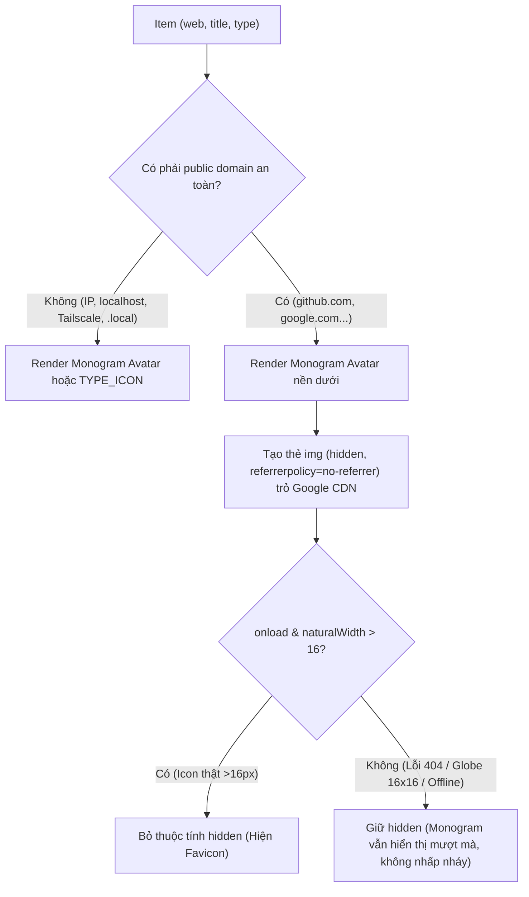

# Proposal & Action Plan: WebMCP Vault Favicon & 1Password-Style Monogram Avatar

> **Ngày lập**: 2026-10-18  
> **Quy trình Điều phối**: Multi-AI Architecture Review (`Gemini Flash 3.8 Writer` + `Gemini 4 Argon High L1 Reviewer` + `Claude Opus 5.5 L2 Final Reviewer`) với lăng kính **/ponytail**  
> **Trạng thái**: **APPROVED WITH MANDATORY HARDENING (Đã thông qua sau phản biện L1 & L2)**  
> **Tài liệu tham chiếu**: [1Password Vault UI Screenshot](file:///Users/ttcenter/.gemini/antigravity/brain/4a0370a3-016d-4493-bb78-32be70c227eb/.user_uploaded/media_1792314846131_fc575c53.png)

---

## 1. Mục Tiêu & Trải Nghiệm Người Dùng (1Password Standard)

Nâng cấp giao diện WebMCP Vault UI (`webmcp-vault-kit`) để mỗi item trong danh sách sở hữu nhận diện thị giác trực quan tương đương **1Password 8**:
1. **Website có Public Domain** (`github.com`, `google.com`, `supabase.com`...): Hiển thị Favicon sắc nét (32x32px, bo góc `border-radius: 7px`).
2. **Không có Domain / Domain nội bộ / Offline / Không có Favicon**: Tự động hiển thị **Monogram Avatar (2 ký tự viết tắt)** trên nền màu pastel trang nhã (ví dụ: *Tino* $\rightarrow$ `Ti` nền be cát, *App Cake* $\rightarrow$ `Ap` nền vàng nhạt, *365otp* $\rightarrow$ `36` nền tím, *Đà Nẵng* $\rightarrow$ `Da` nền xanh rêu).
3. **Typed Items (`ssh_key`, `api_token`, `env`)**: Tái sử dụng `TYPE_ICONS` vector có sẵn, không sinh thêm SVG thừa.
4. **Bảo toàn tính năng Badge Right-End**: Avatar nằm ở cột trái; tiêu đề (`name`) và cụm badge (`LOGIN`, `PASSKEY`) vẫn giữ nguyên vị trí căn phải và hiệu ứng hover quick-actions vừa hoàn thiện.
5. **Đồng bộ Detail Header**: Hiển thị avatar lớn (~40px) ở góc tiêu đề khi xem hoặc chỉnh sửa item.

---

## 2. Kiến Trúc Tối Giản Dưới Lăng Kính `/ponytail`



### Các nguyên tắc `/ponytail` cốt lõi được chốt bởi L1 (Argon) & L2 (Opus):
1. **Rung 3 & 4 (Native Platform First — Tránh Over-engineering Backend Proxy)**:
   - Dùng trực tiếp thẻ `` của trình duyệt trỏ đến Google Favicon CDN (`https://www.google.com/s2/favicons?domain=${domain}&sz=64`).
   - Loại bỏ hoàn toàn ý tưởng viết Node.js Proxy (`/api/favicon`): Không tốn RAM/Disk cache, triệt tiêu 100% rủi ro **SSRF** vào mạng nội bộ.
   - Trình duyệt tự động tận dụng cơ chế HTTP caching đa tầng toàn cầu.
2. **Kỹ thuật Monogram Underlay (Zero Flicker, Zero Complex Error Chaining)**:
   - Thay vì dùng `onerror` để chuyển đổi qua lại giữa ảnh và text (dễ gây giật nháy layout), ta **luôn render Monogram Avatar trước**, đặt thẻ `` phủ lên trên.
   - Khi ảnh tải thành công và `img.naturalWidth > 16` (loại trừ icon quả địa cầu xám mặc định của Google khi domain 404), thẻ `` mới được gỡ cờ `hidden`.
3. **Tuân thủ Tuyệt đối CSP `style-src 'self'`**:
   - Không dùng `style="display:none"` hay inline styles (vì CSP cấm inline style và sẽ chặn không thực thi).
   - Dùng thuộc tính chuẩn HTML `hidden` và các class CSS định nghĩa sẵn: `.mono-0` đến `.mono-7`.
4. **Quyền riêng tư & Zero-Trust Gate**:
   - Bộ lọc `getFaviconHost(item)` loại bỏ 100% các host nội bộ: Mọi địa chỉ IP (IPv4/IPv6), `localhost`, `.local`, `.lan`, `.internal`, `.home.arpa`, `.ts.net` (Tailscale).
   - Bổ sung cờ cục bộ: `localStorage.getItem('vault.favicons') === 'off'` cho phép người dùng tắt hoàn toàn tính năng tải favicon từ bên thứ ba nếu muốn chạy cô lập 100%.

---

## 3. Tổng Hợp Đánh Giá & Phản Biện Đa AI (Audit Trails)

### 3.1. Báo cáo Thẩm định Lớp 1 — Gemini 4 Argon High (Preview Pre-acceptance)
* **Kiến trúc**: Chấp thuận mô hình Direct Browser CDN. Khuyến nghị loại bỏ DuckDuckGo fallback để đơn giản hóa CSP và giảm bề mặt lỗi.
* **CSP & Privacy**: Nhấn mạnh CSP `default-src 'none'` hiện tại sẽ chặn mọi thẻ ảnh nếu không mở `img-src`. Cảnh báo rò rỉ hostname nội bộ nếu không có bộ lọc IP/domain.
* **Monogram Unicode**: Yêu cầu chuẩn hóa NFD và loại bỏ dấu tiếng Việt để các ký tự viết tắt không bị lệch tâm trong khung vuông 32x32px.
* **Xung đột CSS**: Phát hiện `.item { display: grid; }` nằm trong [fields.css](file:///Users/ttcenter/Desktop/VIBE_CODE/webmcp-automation-kit/packages/webmcp-vault-kit/lib/ui/styles/fields.css#L19), mà `fields.css` nạp sau `layout.css`. Phải cập nhật trực tiếp tại `fields.css`.
* **Whitelist Asset**: Nhắc nhở thêm `'app/item-icon.js'` vào mảng `ASSETS` trong [ui-server.js](file:///Users/ttcenter/Desktop/VIBE_CODE/webmcp-automation-kit/packages/webmcp-vault-kit/lib/ui-server.js#L28) để tránh lỗi 404 khi load ES Module.

### 3.2. Phán quyết Chung khảo Lớp 2 — Claude Opus 5.5 Final Review
* **Phán quyết**: **APPROVED WITH 2 BLOCKER FIXES (Chấp thuận kèm 2 điều kiện tiên quyết bắt buộc)**.
* **Phát hiện chí mạng B1 (Redirect CSP Blocker)**:
  - Kiểm tra thực tế: `www.google.com/s2/favicons` trả HTTP 301 chuyển hướng về `https://t{1..3}.gstatic.com/faviconV2?...`. Nếu CSP chỉ có `https://www.google.com`, trình duyệt sẽ chặn 100% ảnh sau khi redirect!
  - **Khắc phục**: Khai báo chính xác: `img-src 'self' https://www.google.com https://*.gstatic.com;`. Bỏ `data:` vì không cần thiết.
* **Phát hiện chí mạng B2 (Inline Style Blocker)**:
  - CSP chặn `style=""`. Phải dùng thuộc tính `hidden` và class `.mono-0` .. `.mono-7`.
* **Bảo vệ Drag & Drop**:
  - Gán `img.draggable = false` để tránh việc kéo item sang vault khác bị biến thành kéo file ảnh HTML.
* **Bộ lọc Host Bảo mật (S1)**:
  - Loại bỏ hoàn toàn mọi IPv4/IPv6, port, query và các đuôi mạng cục bộ/Tailscale.

---

## 4. Kế Hoạch Triển Khai Chi Tiết (Implementation Checklist)

### Phase 1: Cấu hình CSP Server & Whitelist Asset ([ui-server.js](file:///Users/ttcenter/Desktop/VIBE_CODE/webmcp-automation-kit/packages/webmcp-vault-kit/lib/ui-server.js))
- [ ] Thêm `'app/item-icon.js'` vào mảng `ASSETS` trong `lib/ui-server.js`.
- [ ] Cập nhật CSP header trong `sendHtml`:
  ```javascript
  "img-src 'self' https://www.google.com https://*.gstatic.com",
  ```
- [ ] Cập nhật unit test trong [vault-ui-server.test.mjs](file:///Users/ttcenter/Desktop/VIBE_CODE/webmcp-automation-kit/packages/webmcp-vault-kit/tests/unit/vault-ui-server.test.mjs) xác nhận CSP `img-src` mới.

### Phase 2: Xây dựng Module Frontend [item-icon.js](file:///Users/ttcenter/Desktop/VIBE_CODE/webmcp-automation-kit/packages/webmcp-vault-kit/lib/ui/app/item-icon.js) (~60 LOC)
- [ ] Hàm `getFaviconHost(item)`:
  - Kiểm tra cờ tắt: nếu `localStorage.getItem('vault.favicons') === 'off'` trả `''`.
  - Parse an toàn qua `new URL()`.
  - Chặn IPv4/IPv6, localhost, `.local`, `.lan`, `.internal`, `.home.arpa`, `.ts.net`.
  - Bắt buộc hostname phải chứa ít nhất 1 dấu chấm `.`.
- [ ] Hàm `getMonogram(title)`:
  - Chuẩn hóa Unicode `NFD`, thay thế thủ công `đ/Đ -> d/D`, xóa dấu phụ `[\u0300-\u036f]`.
  - Trích xuất 2 ký tự đầu qua `Array.from()` (tránh cắt đôi emoji).
- [ ] Bảng màu Pastel Hash DJB2:
  - Gán class `.mono-0` đến `.mono-7` dựa trên `hash(title) % 8`.
- [ ] Hàm `createItemAvatar(item, { size = 32 } = {})`:
  - Tạo container `.item-avatar-box`.
  - Nếu là `ssh_key`, `api_token`, `env` mà không có web: nhúng icon vector `TYPE_ICONS[type]`.
  - Nếu có public host: nhúng Monogram làm nền, kèm thẻ ``.
  - Sự kiện `img.onload`: nếu `img.naturalWidth > 16`, gỡ bỏ thuộc tính `hidden` của ảnh và ẩn monogram.

### Phase 3: Nâng cấp Bố cục Giao diện Danh sách ([fields.css](file:///Users/ttcenter/Desktop/VIBE_CODE/webmcp-automation-kit/packages/webmcp-vault-kit/lib/ui/styles/fields.css), [layout.css](file:///Users/ttcenter/Desktop/VIBE_CODE/webmcp-automation-kit/packages/webmcp-vault-kit/lib/ui/styles/layout.css) & [item-list.js](file:///Users/ttcenter/Desktop/VIBE_CODE/webmcp-automation-kit/packages/webmcp-vault-kit/lib/ui/app/item-list.js))
- [ ] Trong `fields.css`: Chuyển `.item` từ `display: grid` sang `display: flex; align-items: center; gap: var(--s2);`.
- [ ] Trong `layout.css`: Thêm styling cho `.item-avatar-box`, `.item-favicon`, `.item-monogram`, và các class màu pastel `.mono-0` .. `.mono-7` (hỗ trợ cả Light Mode & Dark Mode).
- [ ] Trong `item-list.js`:
  - Import `createItemAvatar` từ `./item-icon.js`.
  - Đóng gói nội dung văn bản vào `.item-body` (`flex: 1 1 auto; min-width: 0;`).
  - Gắn avatar vào đầu button: `button.append(avatar, body)`.

### Phase 4: Đồng bộ Header Xem Chi Tiết ([view-fields.js](file:///Users/ttcenter/Desktop/VIBE_CODE/webmcp-automation-kit/packages/webmcp-vault-kit/lib/ui/app/view-fields.js) & [vault-ui.html](file:///Users/ttcenter/Desktop/VIBE_CODE/webmcp-automation-kit/packages/webmcp-vault-kit/lib/ui/vault-ui.html))
- [ ] Thêm container `<div id="detailAvatar" class="item-avatar-box detail-avatar"></div>` trong `.detail-hero` của `vault-ui.html`.
- [ ] Cập nhật `fillForm` trong `controller.js` / `view-fields.js` để render avatar kích thước 40px tương ứng khi chọn item.

### Phase 5: Kiểm Thử Tự Động & Nghiệm Thu
- [ ] Tạo test unit kiểm định hàm `getFaviconHost` và `getMonogram` trên các edge cases (tiếng Việt, emoji, IP nội bộ).
- [ ] Chạy `npm test` và `node --test tests/unit/vault-ui-server.test.mjs`.
- [ ] Restart daemon trên port 7876 và xác nhận:
  - GitHub, Google hiện đúng favicon sắc nét.
  - Tino, App Cake, 365otp hiện đúng Monogram màu pastel chuẩn 1Password.
  - Không có cảnh báo CSP trong Console trình duyệt.
  - Kéo thả item giữa các vault vẫn hoạt động hoàn hảo.
  - Hover hiển thị quick-actions mượt mà không vỡ layout.
