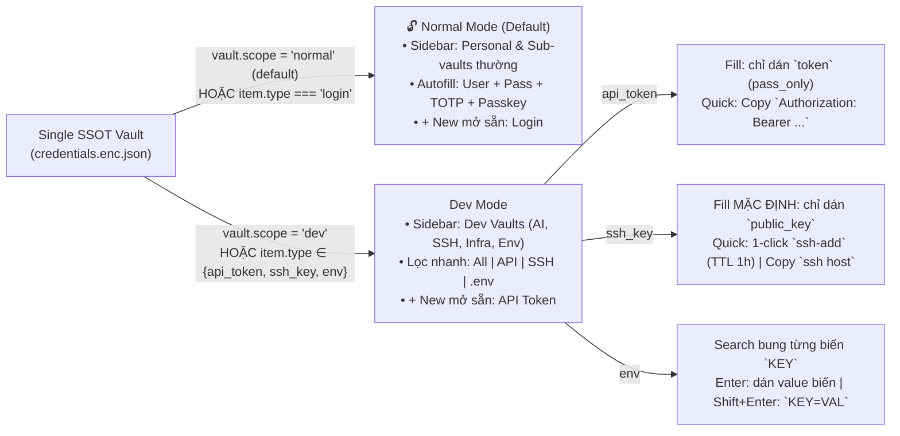

# Đánh Giá Toàn Diện Mức Độ Best-in-Class & Kiến Trúc Tách Normal Vault ↔ Dev Vault Cho `webmcp-vault-kit`

> **Mã tài liệu**: `AUDIT-VAULT-2026-11`  
> **Phạm vi kiểm toán**: `apps/webmcp-vault-kit` (`v1.2.0` / Core + macOS Native + Chrome Extension + CLI)  
> **Đối chiếu chuẩn ngành**: `1Password 8.12.44` (kiểm toán tĩnh + REA tại `/Applications/1Password.app`), Bitwarden, Proton Pass, KeePassXC, và nghiên cứu bảo mật Autofill DOM Clickjacking (Marek Tóth, DEF CON 33, 08/2025)  
> **Lăng kính thiết kế**: `/ponytail` (YAGNI, Zero-Dependency, tận dụng lõi sẵn có, không over-engineer)  
> **Ngày lập**: 2026-11-18

---

## 1. Kết Luận Điều Hành (Executive Verdict)

Nếu tách theo **hai phân khúc mục tiêu**, `webmcp-vault-kit` đang đứng ở hai vị thế rất khác nhau:

| Phân khúc đánh giá | Điểm tổng hợp | Trạng thái | Nhận định cốt lõi |
| :--- | :---: | :--- | :--- |
| **1. Local-First Agentic & Automation Vault** (phục vụ AI Agent, CDP Browser Farm, CLI scripts) | **9.2 / 10** | **Đã đạt Best-in-Class** | Thiết kế `0` dependency kiểm toán được 100%, `leases` giới hạn thời gian/số lượt, `grants` chuẩn JCS SHA-256 + Ed25519 `approval-receipt`, CDP `broker.js` điền form không lộ plaintext vào LLM context (`secretReturned: false`). |
| **2. Trình Quản Lý Mật Khẩu Đa Năng & Dev Vault Hàng Ngày** (so sánh 1:1 với 1Password 8 / Bitwarden / Proton Pass) | **7.6 / 10 (~78%)** | **Đã hoàn chỉnh lõi thực chiến, CHƯA đạt 100% Best-in-Class** | Đã có AES-256-GCM + `scrypt`, Passkey ES256/EdDSA, TOTP, Touch ID, Universal Autofill `Cmd + \`, Extension search đa vault; **nhưng thiếu 5 chốt chặn quan trọng** về vòng đời Lock server, an toàn dữ liệu (History/Trash), chống DOM Clickjacking, đồng bộ merge từng item và luồng Dev Fill riêng cho `api_token` / `ssh_key` / `env`. |

> [!IMPORTANT]
> **Không cần đập đi xây lại kiến trúc**: Lõi mật mã học, `model.js`, `leases.js` và `WebMCPVaultApp.m` của chúng ta đã rất sạch. Chỉ cần vá đúng **3 lỗi/thiếu sót P0 (~220 LOC)** và bổ sung **Switch `Normal Vault ↔ Dev Vault` trên cùng 1 Encrypted Store (~300 LOC)** là có thể đạt chuẩn công nghiệp mà vẫn giữ nguyên triết lý `0` dependency bên ngoài.

---

## 2. Bằng Chứng Kiểm Toán Tĩnh 1Password `v8.12.44` Qua REA (`reverse-engineer-anything`)

Để đánh giá công bằng dựa trên sản phẩm thương mại đầu bảng đang chạy thực tế trên macOS, chúng tôi đã dùng toolset `rea` đối chiếu kiến trúc các binary của `/Applications/1Password.app` (`v8.12.44`):

| Thành phần 1Password 8 | Kích thước / Kiến trúc | REA Evidence ID & Quan sát thực tế | Bài học áp dụng cho `webmcp-vault-kit` |
| :--- | :--- | :--- | :--- |
| **`1Password.app` (Electron + Rust Core)** | Electron `app.asar` + `Contents/Frameworks/index.node` (`177 MB`) | `ev_f0d595ccda9002e4d2313b0dd2281b702f61021add24cd4e310acd79a7ce7807` & `ev_d81109be2ff7b0413ad3e84584ead47e395cfadec181d901bc54ad8a0a0d1f0c`: Codebase Rust `1P:*` phân tách rạch ròi `op-app`, `op-crypto`, `op-system-auth-enclave`, `op-brain-*`, `op-service-developer-environment`, `op-ssh-agent`, `op-view-item` (`history.rs`, `deleted.rs`). | Giữ tách biệt rạch ròi giữa UI shell (`lib/ui/`, `WebMCPVaultApp.m`) với Engine (`lib/store.js`, `lib/vault/*`). Bắt buộc bổ sung **History** và **Recently Deleted** (`Trash`). |
| **`1Password-BrowserSupport`** | `8.34 MB` arm64 Mach-O (Rust), helper thường trực (`PID 1515`) | `ev_c21725c712468c3d2e449ed696e5d80e4d031a4da2d39751e611bfb451186307`: Daemon trung gian giao tiếp với browser extension và chính sách nguồn gốc tab trước khi nhả credential. | Mô hình này của 1Password rất giống `background.js` $\rightarrow$ `http://127.0.0.1:7876` của ta, nhưng `webmcp-vault-kit` gọn hơn vì bỏ qua được Native Messaging host XML cài đặt phức tạp. |
| **`1Password Autofill Extension.appex`** | App Extension (`com.apple.authentication-services-credential-provider-ui`) | `ev_108c47d56fcad2f09c2657e7dfb2850edd15cd36371de47dc9a9a8383e06718d` & `ev_f197c5ab4b0ecb020d1f9117abe73d7f6eade8749ddc118323183fbc3efa5f88`: Móc trực tiếp vào OS Credential Provider của Apple (cấp hệ điều hành, cần App Store / Provisioning profile). | Bản `WebMCPVaultApp.m` dùng Carbon `RegisterEventHotKey` (`Cmd + \`) + `AXUIElement` + concealed pasteboard đã giải quyết 90% bài toán điền vào app/terminal macOS mà **không cần Developer ID + Provisioning Profile** nặng nề. |
| **`1password-mcp`** | `8.1 MB` arm64 Rust binary, Team ID `2BUA8C4S2C`, `rmcp 1.8.0` STDIO | `ev_3314931864d01578335e7a6aa6bd5c67670a7cd2fbc96f4fc61a7bc235f132eb` & `ev_6ab27a58d7382b355593c334fbbe84f9b7b84263bd60b92dae84eb2b21edc4bd`: MCP Server hợp nhất `developer_environments` + `PAM`. Chỉ trả danh sách **tên biến** (`list_secrets`), không trả raw value vào context model; cần phê duyệt trên Desktop App. | `webmcp-vault-kit` đã làm rất tốt phần này thông qua `broker.js` (`secretReturned: false`) và `grants.js`, chỉ cần giữ vững kỷ luật không lộ plaintext qua output/MCP. |
| **`op-ssh-sign`** | `1.28 MB` arm64 Rust binary (`op-openssh-keys`) | `ev_0a7337dcea7fda9164cd4fca6e041aab6ede57dd660df570b249842fb5533185` & `ev_c261a7d9a5f3e58b5f9b889e2ecd812fff475783e113c1d800c7730b44a91a51`: Binary chuyên dụng ký Git commit thông qua `SSH_AUTH_SOCK` của 1Password. | Cho thấy nhu cầu thực tế của dev là **SSH Signing & `ssh-agent` không ghi key trần lên `~/.ssh`**. Tuy nhiên dưới góc nhìn `/ponytail`, chúng ta không cần viết custom SSH socket daemon đồ sộ ngay, chỉ cần nâng cấp luồng `ssh-add` hiện có. |
| **`app.asar/primaryRenderer.js`** | Frontend Router & Sidebar Architecture | Route riêng `/:collectionUuid/developer` tách biệt hoàn toàn khỏi Vault thường, bật qua cờ `developerExperienceEnabled`, gồm 5 trụ cột: `SSH Agent`, `Environments` (mount FIFO không lưu `.env` trần lên đĩa), `CLI`, `Developer Watchtower` (quét file `.env` & SSH key rò rỉ trên đĩa), `MCP Server`. | **Khớp trực tiếp với ý tưởng của người dùng**: Tách không gian **Dev** ra khỏi không gian **Normal Vault** để tránh lẫn lộn giữa mật khẩu web hàng ngày với API token / SSH key / `.env`. |

---

## 3. Đối Chuẩn 8 Trục Kỹ Thuật Cốt Lõi (`webmcp-vault-kit` vs Chuẩn Ngành)

### 3.1. Trục 1 — Mật mã học, Quản lý Khóa & Vòng đời Lock (`7.0 / 10`)

- **Điểm mạnh đã kiểm chứng**:
  - Mã hóa đối xứng chuẩn `aes-256-gcm` với IV ngẫu nhiên `12` bytes và Auth Tag `16` bytes (`lib/vault/envelope.js:10, 84-86, 170-187`).
  - KDF `scrypt` mặc định `N = 16384, r = 8, p = 1, keyLength = 32` (`envelope.js:15-31`).
  - Ghi file nguyên tử siêu an toàn qua `writePrivateFile()` (`lib/vault/fs-safe.js:24-53`): cờ tạo file độc quyền `'wx'`, quyền `0o600`, `fsyncSync` file + thư mục, kiểm tra ownership lockfile theo `(ino, dev)` + `nonce` + dọn stale lock theo PID (`STALE_LOCK_MS = 30000`, `fs-safe.js:9-10`), kèm kiểm tra chống ghi đè bằng SHA-256 `assertFileUnchanged()` (`lib/store.js:93-111`).
- **Lỗ hổng & Giới hạn cần vá**:
  1. **[P0 BUG] Bấm `Lock` trên Web UI nhưng Server vẫn mở khóa trong `10` phút**:
     - Khi bấm `#lockButton` (`lib/ui/app/main.js:348-363`), trình duyệt chỉ xóa `state.key = ''` ở client, **không hề gọi API xóa khóa trên backend**.
     - Trong khi đó, `lib/ui-server.js:14-33` vẫn giữ nguyên biến `sessionUnlockedKey` trong RAM với **sliding TTL 10 phút** (`SESSION_UNLOCK_TTL_MS = 10 * 60 * 1000` — mỗi lần `getSessionUnlockedKey()` được gọi lại gia hạn thêm 10 phút!).
     - Kết hợp với `checkToken()` (`lib/ui-server.js:228-233`) cho phép mọi request mang header `Origin: chrome-extension://...` trên loopback/LAN đi qua mà không cần `x-webmcp-vault-token`, điều này nghĩa là **ngay cả khi bạn vừa bấm Lock trên App/Web UI, Extension hoặc tiến trình nội bộ vẫn có thể đọc/điền mật khẩu trong tối đa 10 phút nếu không tắt tiến trình server**.
  2. **Thiếu Memory Zeroization (`Buffer.fill(0)`)**:
     - `key`, `plaintext`, `decrypted` trong `lib/vault/envelope.js:172-198` là các `Buffer` nhạy cảm nhưng chưa được `.fill(0)` trong khối `finally` sau khi mã hóa/giải mã.
  3. **Chưa bọc khóa DEK (Envelope Encryption) & tái sử dụng `kdf.salt` khi lưu**:
     - `saveVault()` (`lib/store.js:109`) truyền lại `existing?.kdf || null`, tức mỗi lần sửa item chỉ đổi `iv` mà giữ nguyên `kdf.salt` cũ (chỉ đổi salt lúc `init` hoặc `rotateKey()`).
     - `requireStrongKey()` (ép tối thiểu 32 bytes, `lib/vault/key-source.js:169-173`) hiện mới được ép ở `rotateKey()` (`lib/vault/backup.js:46`), chưa ép ở bước `init` nếu user nhập master password ngắn. So với Bitwarden/1Password dùng **Argon2id** (chống GPU/ASIC tốt hơn `scrypt N=16384`) + mô hình DEK tách rời giúp đổi mật khẩu chính nhanh hơn.

### 3.2. Trục 2 — Chống Mất Dữ Liệu & Đồng Bộ Đa Thiết Bị (`6.0 / 10`)

- **3 khoảng trống lớn so với 1Password / Bitwarden**:
  1. **[P0 GAP] Không có Lịch sử Mật khẩu (`passwordHistory`)**: `updateItem()` (`lib/store.js:245-264`) và `upsertLoginCredential()` (`lib/store.js:615-632`) ghi đè thẳng `item.password`. Nếu bạn đổi mật khẩu một trang web, Extension auto-save mật khẩu mới xong trang web báo lỗi session/reject, mật khẩu cũ coi như **mất vĩnh viễn** nếu chưa kịp backup file.
  2. **[P0 GAP] Không có Thùng Rác / Xóa Mềm (`Trash` / `deletedAt`)**: `deleteItem()` (`lib/store.js:265-273`) lọc vĩnh viễn item khỏi `vault.items` và lưu đè file ngay lập tức (1Password giữ trong *Recently Deleted* 30 ngày).
  3. **[P1 GAP] Đồng bộ đa máy (`sync-vault.mjs`) ghi đè nguyên cục file, dễ mất dữ liệu 2 chiều (Split-Brain)**:
     - `skills/webmcp-vault/scripts/sync-vault.mjs:249-321` dùng `rsync -avz` kéo/đẩy toàn bộ `credentials.enc.json` (tuy có tạo bản backup `credentials.pre-pull.*.enc.json` / `pre-push.*.enc.json`, nhưng nếu bạn sửa tài khoản A trên Mac chính và sửa tài khoản B trên Mac M1 `.69` cùng lúc, `push`/`pull` sẽ đè mất bên kia chứ không merge theo `item.id` + `updatedAt`).
  - Ngoài ra chưa có Custom Fields cho `login`, chưa hỗ trợ nhiều URL/rule khớp `never` trên một `login` (chỉ có 1 chuỗi `web` tại `lib/vault/model.js:161`), chưa có loại `secure_note` độc lập hay Export chuẩn (`.csv` / JSON).

### 3.3. Trục 3 — Browser Extension Autofill & Phòng Thủ DOM Clickjacking hậu DEF CON 33 (`7.5 / 10`)

- **Điểm mạnh hiện có**:
  - `webmcp-vault-extension/dist/manifest.json:17-40` tách rạch ròi `vault-content.js` chạy ở `"world": "ISOLATED"` và `passkey-main.js` ở `"world": "MAIN"`, đồng thời khóa `"all_frames": false` (chỉ chạy top-level frame, chặn tấn công từ iframe quảng cáo nhúng).
  - Giao diện inline selector dùng `attachShadow({ mode: 'closed' })` (`vault-content.js:43, 82, 425, 500, 922`).
  - `background.js:566-626` xác thực nguồn URL phải là `https:` hoặc `localhost`/`127.0.0.1` và kiểm tra `resolveValidRpId()` từ phía service worker trước khi gọi API.
  - Phiên bản `v1.2.0` đã có tìm kiếm toàn vault (`/api/credentials/search`) và lazy reveal theo đúng 1 item được chọn (`/api/credentials/fill-item`).
- **[P0 SECURITY GAP] Chưa vá đầy đủ chuẩn chống DOM Extension Clickjacking (Marek Tóth, DEF CON 33 — 08/2025)**:
  - Nghiên cứu DEF CON 33 chỉ ra 11 trình quản lý mật khẩu lớn (kể cả 1Password/Bitwarden thời điểm công bố) từng bị khai thác bằng cách dùng CSS `opacity: 0`, `filter`, `clip-path` hoặc lớp phủ trong suốt để lừa người dùng click vào nút ẩn hoặc kích hoạt autofill vào input tàng hình trên trang bị XSS.
  - Trong `webmcp-vault-extension/dist/content-scripts/vault-content.js`:
    1. Hàm `isVisibleInput(el)` (`dòng 235-242`) chỉ kiểm tra `disabled`, `readOnly`, `rect.width === 0 || rect.height === 0`, `display === 'none'`, `visibility === 'hidden'`. **Chưa kiểm tra `opacity === 0` (hoặc ancestor có `opacity < 0.8`), nằm ngoài viewport (`left: -9999px`), `clip-path`, `transform: scale(0)`, và chưa kiểm tra che phủ bằng `document.elementFromPoint(cx, cy)`**.
    2. `runPasswordAutofill()` (`dòng 897-904`) tự động điền mật khẩu ngay trên sự kiện `focusin` thụ động nếu `candidates.length === 1` và ô đang trống (`userEmpty && passEmpty`) — nghĩa là kịch bản XSS trên một domain hợp pháp có thể tạo `<input type="password" style="opacity:0;position:fixed;left:-9999px">` rồi gọi `.focus()` để đánh cắp mật khẩu mà không cần cú click thật (`event.isTrusted === true`)!

### 3.4. Trục 4–8 — Tóm Tắt Điểm Chuẩn Còn Lại

| Trục đánh giá | Điểm | Đánh giá hiện trạng & bằng chứng |
| :--- | :---: | :--- |
| **4. OS-Level Native Autofill & Biometrics** | **8.5 / 10** | Đã triển khai `Cmd + \` (`WebMCPVaultApp.m:337-645`) với `kCGEventSourceStatePrivate` an toàn bộ gõ Tiếng Việt, `AXSecureTextField` + nhận diện Terminal, `ConcealedType` / `TransientType` pasteboard tự xóa theo `changeCount`, và `LAContext` Touch ID (`lib/vault/touchid.js`). Lưu ý nhỏ: clipboard auto-clear đang lệch nhau nhẹ (`90s` ở `popup.js:116` vs `60s` ở `lib/ui/app/status.js:212`). |
| **5. Password Hygiene / Watchtower** | **3.5 / 10** | Mới có sinh mật khẩu ngẫu nhiên `20` ký tự; chưa có báo cáo mật khẩu yếu/trùng lặp, site HTTP, thiếu 2FA, token sắp hết hạn (`expires_at` mới là trường text gợi ý trong `lib/ui/app/config.js:23`) hay kiểm tra HIBP k-anonymity. |
| **6. Developer Secrets Workflow** | **CLI: 7.5/10**<br>**Fill UX: 4.0/10** | Schema đã có `api_token`, `ssh_key`, `env`; CLI có `run` (inject `vault://` + redact stdout/stderr, `bin/webmcp-vault.mjs:489-544`), `ssh-add` (`471-487`), `env-import` (`580-611`). Nhưng **luồng Fill bị khóa cứng ở `login`**: `searchAutofillItems` (`lib/store.js:744`), `getAutofillItemById` (`lib/store.js:777`) và `triggerMacAutofill` (`lib/ui/app/item-list.js:171`) đều từ chối mọi item `type !== 'login'`. `ssh-add` cũng chưa tự truyền `passphrase` nếu key có passphrase. |
| **7. Agentic & MCP Security** | **9.5 / 10** | Dẫn đầu phân khúc với `leases.js` (`maxUses`, `TTL <= 600s`, ràng buộc `siteOrigin`/`profileBindingId`), `grants.js` (`metadata-only` / `scoped-values` / `export`), `approval-receipt.js` (Ed25519), và `broker.js` (CDP Virtual Authenticator + field digest SHA-256). (`grant` mới dùng nội bộ, chưa nối subcommand ra CLI `bin/webmcp-vault.mjs`). |
| **8. Zero-Dependency Footprint** | **10 / 10** | `package.json:1-47` xác nhận **0 runtime dependencies và 0 devDependencies** — chỉ dùng Node.js built-in + `clang`/`swiftc` trên macOS. Không thể bị tấn công chuỗi cung ứng npm. |

---

## 4. Lộ Trình Nâng Cấp Lên Best-in-Class Theo Lăng Kính `/ponytail`

Áp dụng nguyên tắc `/ponytail` (**tận dụng lõi sẵn có, không thêm thư viện ngoài, cắt bỏ tính năng thừa YAGNI**):

### 4.1. Nhóm P0 — Bắt Buộc Vá Ngay (~220 LOC tổng cộng)
1. **Đóng vòng đời Lock thực sự trên Server + Zeroize RAM (~25 LOC)**:
   - Thêm endpoint `POST /api/lock` trong `lib/ui-server.js` để xóa ngay `sessionUnlockedKey = null; sessionUnlockedExpiresAt = 0;`.
   - Gọi `POST /api/lock` từ `#lockButton` (`lib/ui/app/main.js:348`) và nút Lock trên Extension Popup.
   - Bổ sung `try { ... } finally { key.fill(0); }` (và `plaintext.fill(0)` / `decrypted.fill(0)`) trong `lib/vault/envelope.js:170-203`.
2. **Chống mất dữ liệu bằng `passwordHistory` + `Trash` mềm (~110 LOC)**:
   - Trong `updateItem()` và `upsertLoginCredential()` (`lib/store.js:245-264, 615-632`): mỗi khi `password` thay đổi, đẩy mật khẩu cũ vào mảng `item.passwordHistory` (giới hạn `10` bản ghi gần nhất `{ value, changedAt }`).
   - Trong `deleteItem()` (`lib/store.js:265-273`): thay vì xóa cứng ngay, gán `item.deletedAt = nowIso()`; mặc định `listItems` / autofill bỏ qua item có `deletedAt`, thêm mục **Trash** ở cuối sidebar để `Restore` hoặc `Empty Trash` (tự động xóa vĩnh viễn sau 30 ngày).
3. **Chống DOM Extension Clickjacking chuẩn DEF CON 33 (~85 LOC)**:
   - Trong `vault-content.js`:
     - Bỏ tự động điền thụ động trên `focusin` (`dòng 897-904`) cho các ô mật khẩu — chỉ bật **Inline Badge/Menu** gần input và chỉ thực hiện `fillCandidate()` khi có thao tác người dùng xác thực (`event.isTrusted === true` hoặc phím tắt `Alt+K`).
     - Nâng cấp `isVisibleInput(el)` (`dòng 235-242`): kiểm tra input và các thẻ tổ tiên đều có `opacity >= 0.8`, kích thước `>= 12x12`, nằm trong viewport (`rect.right > 0 && rect.left < innerWidth && ...`), không bị `clip-path: inset(100%)`, và `document.elementFromPoint(cx, cy)` tại tâm ô nhập phải trúng chính `el` hoặc label/wrapper của nó (chống lớp phủ tàng hình).

### 4.2. Nhóm P1 — Nâng Tầm Vận Hành Đa Máy & An Toàn Vệ Sinh Mật Khẩu (~250 LOC)
1. **Per-Item Merge trong `sync-vault.mjs`**: Thay vì `rsync` đè nguyên file, giải mã cả bản local và remote trong RAM (cùng key), hợp nhất theo `item.id` dựa trên `updatedAt` + `deletedAt` tombstone (tạo bản sao `(Conflict)` nếu cả hai sửa cùng 1 item mà khác nội dung), rồi mã hóa atomic lại.
2. **Local Watchtower View (100% offline trước, HIBP opt-in)**: Quét tại `store` hoặc UI tab nhỏ: mật khẩu trùng (`Reused`), mật khẩu yếu (`< 12` ký tự), URL `http://`, tài khoản thiếu TOTP/Passkey, và `api_token` có `expires_at` sắp hết hạn. Nút *"Check Breaches (HIBP)"* gửi **chỉ 5 ký tự đầu SHA-1** (k-anonymity) khi người dùng chủ động bấm.
3. **Lệnh `webmcp-vault inject`**: Đọc file template (ví dụ `.env.example` hoặc `config.tpl`), thay thế `{{ vault://item/field }}`, xuất ra file runtime quyền `0o600` không bao giờ commit vào Git.

### 4.3. Những Gì `/ponytail` KHUYÊN KHÔNG LÀM (Tránh Over-Engineering)
- **Không kéo WebAssembly Argon2id hay native C++ addon**: Giữ nguyên `0` dependencies bằng `node:crypto` `scrypt` (có thể nâng mặc định `N` lên `32768` cho vault mới trong giới hạn `validateKdf` hiện tại ở `envelope.js:65`), vì key lưu Keychain / file của chúng ta đã là 256-bit random — điểm yếu duy nhất chỉ xảy ra nếu người dùng tự đặt master password ngắn ở `init` (chỉ cần ép `requireStrongKey()` hoặc cảnh báo ở `init`).
- **Không viết custom `SSH_AUTH_SOCK` daemon bằng Node.js**: Viết giả lập OpenSSH agent protocol + ED25519/RSA signing loop rất dài và dễ lỗi tương thích OpenSSH; tận dụng chính `ssh-add -t <ttl>` của macOS kết hợp `SSH_ASKPASS` tạm thời (nếu có `passphrase`) giải quyết gọn ghẽ 95% nhu cầu với ~35 LOC.
- **Không nhồi 20+ Category tiêu dùng** như `Medical Record`, `Outdoor License`, `Rewards`, `Driver License` của 1Password — giữ đúng `login`, `api_token`, `ssh_key`, `env` (có thể thêm `note` nếu thực sự cần).

---

## 5. Đánh Giá & Thiết Kế Kiến Trúc Cho Ý Tưởng Tách **Normal Vault ↔ Dev Vault** & Switch Tại Icon Header

### 5.1. Đánh giá tính hợp lý của ý tưởng dựa trên thực trạng UI & hành vi sử dụng

Theo ảnh chụp giao diện hiện tại của bạn (`media_1794977207958_df8dff27.png` — cụm `.brand` chứa icon ổ khóa mở + `WebMCP Vault` ngay phía trên `VAULTS` / `All items 257`), đây là **một quyết định thiết kế UX cực kỳ hợp lý vì 3 lý do kỹ thuật xác thực**:

1. **Giải quyết nhiễu bối cảnh thực tế (`257+` items)**: Toàn bộ hệ sinh thái `VIBE_CODE` đang lưu nhiều loại secret dev khác nhau trong `webmcp-vault` (OAuth `client_id` / `client_secret` / `refresh_token` cho YouTube Analytics `yt_analytics_report.py`, token `rclone` cho `archive_sync.py`, API keys, SSH keys, `.env` bundles). Khi nằm chung `All items`, việc bấm `Cmd + \` để tìm tài khoản login web bị lẫn các token dev — và ngược lại.
2. **Tách biệt hoàn toàn ngữ nghĩa Autofill (Điểm quyết định an toàn)**:
   - Một mục `login` khi Fill sẽ điền `username + Tab + password` (hoặc Passkey / TOTP).
   - Một mục `ssh_key` tuyệt đối **KHÔNG ĐƯỢC điền `private_key` PEM vào ô input trên web/terminal** — khi Fill mặc định phải điền **`public_key`** (vào GitHub/GitLab/Cloudflare), hoặc chạy **`ssh-add`** nạp vào agent!
   - Một mục `api_token` cần Fill 1 nhát **chỉ trường `token`** (`pass_only`) hoặc copy `Authorization: Bearer ...`.
   - Một mục `env` cần **chọn từng key cụ thể** (`OPENAI_API_KEY`, `DATABASE_URL`) để điền nhanh chứ không thể điền cả cục 30 dòng `.env` vào 1 ô password.
3. **Phát hiện kiến trúc quan trọng từ CSS (`lib/ui/styles/layout.css:82-84`)**:
   - Trong chế độ `Cmd + \` / Menu Bar Popover (`html.is-mac-popover`), toàn bộ thanh bên `.vault-sidebar` (`VAULTS`) bị ẩn hoàn toàn (`display: none !important`) để tiết kiệm diện tích.
   - Phần tử **duy nhất luôn hiện diện đồng nhất trên cả 3 giao diện** (Full Mac App sau nút đèn giao thông `padding-left: 86px`, `Cmd + \` Popover `min-height: 44px`, và Web UI) chính là cụm **`.brand` trên `<header class="bar">` (`lib/ui/vault-ui.html:162-188`)**! Vì vậy, biến chính icon/cụm `.brand` ở góc trên-trái thành **Mode Switch (`Normal Vault` ↔ `Dev Vault`)** sẽ giúp chuyển ngữ cảnh tức thì chỉ với **1 cú click hoặc phím tắt** ngay cả khi đang mở Popover nhỏ gọn.

---

### 5.2. So sánh 3 phương án lưu trữ dưới lăng kính `/ponytail`

| Tiêu chí | Phương án A: Tách thành 2 file `.enc.json` vật lý riêng | Phương án B: Chỉ thêm 1 folder `"Dev"` trong cây `VAULTS` hiện tại | Phương án C (KHUYẾN NGHỊ): **1 Encrypted Store SSOT + `scope: 'normal' \| 'dev'` + Mode Switch tại `.brand`** |
| :--- | :--- | :--- | :--- |
| **Tương thích CLI & Scripts sẵn có** (`yt_analytics_report.py`, `archive_sync.py`, `storage-bindings.mjs`, `run`, `ssh-add`) | ❌ Gãy hoặc phải thêm cờ `--dev` / truyền 2 session unlock key khác nhau cho mọi lệnh. | ✅ Tương thích 100%. | ✅ **Tương thích 100%** (CLI `read`/`run`/`ssh-add`/`lease` vẫn đọc chung 1 kho, không vỡ bất kỳ automation nào). |
| **Độ phức tạp Lock, Backup, Sync sang Mac M1 `.69`** | ❌ Nhân đôi `credentials.enc.json`, nhân đôi `withFileLock`, nhân đôi `rotateKey`, nhân đôi `sync-vault.mjs`, Extension phải quản lý 2 trạng thái unlocked khác nhau. | ✅ Không thêm file. | ✅ **Đơn giản tối đa**: 1 lần Touch ID mở khóa, 1 bản backup, 1 lệnh đồng bộ sang Mac M1 `.69`. |
| **Tách riêng UX `All items (257)` & cây Sub-vaults cho Dev** | ✅ Tách hẳn. | ❌ Vẫn cộng vào `All items (257)` và không có cây sub-vaults riêng biệt gọn gàng khi ở chế độ Popover. | ✅ **Tách biệt hoàn toàn về mặt hiển thị & tìm kiếm**: Normal chỉ thấy `login` + normal vaults; Dev chỉ thấy `api_token`/`ssh_key`/`env` + dev vaults (như `AI Keys`, `SSH`, `Cloudflare`, `Env`). |
| **Step-Up Bảo Mật (Yêu cầu Touch ID riêng khi vào Dev Vault)** | ✅ Khóa riêng. | ❌ Không có. | ✅ **Hỗ trợ tùy chọn Step-Up Policy**: Có thể cấu hình *"Yêu cầu Touch ID khi chuyển sang Dev Mode hoặc Fill/Copy `private_key`/`token`"* mà không cần tách 2 file mã hóa. |

**Kết luận kiến trúc**: Chọn **Phương án C**.

---

### 5.3. Thiết kế Chi Tiết Kiến Trúc Mode Switch `Normal ↔ Dev`

#### A. Luồng dữ liệu & Phân vùng Logic (Data & Perspective Model)



**Quy tắc phân loại không cần migrate thủ công (`Zero-Migration Rule`)**:
- Không cần đụng tay chuyển đổi 257 items đang có.
- Metadata mỗi thư mục vault (`vault` object) thêm trường tùy chọn `scope: 'normal' | 'dev'` (nếu thiếu mặc định hiểu là `'normal'`). Hệ thống tự đảm bảo có một vault gốc Dev mặc định (ví dụ `id: 'dev', name: 'Developer', scope: 'dev', isDefaultDev: true`) hoặc gộp hiển thị mọi item `api_token | ssh_key | env` hiện có vào chế độ **`</> Dev`** ngay lập tức bất kể trước đó item đang nằm ở folder nào (hoặc cho phép nút *Move existing dev items to Developer vault* tùy chọn).
- Nếu người dùng đang lưu 1 item `login` thuần (ví dụ tài khoản console AWS/Cloudflare) vào 1 folder có `scope === 'dev'`, item đó cũng đi theo folder Dev; ngược lại các item `api_token` / `ssh_key` / `env` luôn thuộc không gian **`</> Dev`**.
- **Bảo vệ ngược khi tạo mới**: Khi đang đứng ở chế độ `🔓 Normal`, form `+ New` mặc định tạo `login`; khi chuyển sang `</> Dev`, form `+ New` mặc định tạo `api_token` (với chip chuyển nhanh `API Token | SSH Key | Env`) và tự chọn `vaultId` là vault Dev đang mở.

#### B. Thiết kế Giao diện Cụm `.brand` Switch trên 3 Mặt Bằng UI

1. **Desktop App & Web UI (`lib/ui/vault-ui.html:162-188` & `lib/ui/styles/layout.css:155-174`)**:
   - Biến phần icon `<svg>` ổ khóa mở + tiêu đề bên trái `.brand` thành một **Segmented Pill Switch 2 trạng thái** nhỏ gọn (cao `28px–30px`, rộng vừa khít bên phải đèn giao thông macOS `padding-left: 86px`):
     ```text
     Normal đang bật:  [ 🔓 Vault ] [ </> ]        (nền sáng/vàng --live, chữ đậm)
     Dev đang bật:     [ 🔓 ]       [ </> Dev ]    (nền xanh lam/tím kỹ thuật --dev, icon dấu nhắc </>)
     ```
   - Có `role="tablist"` / `aria-pressed`, phím tắt nhanh **`Cmd + Shift + D`** (hoặc `Ctrl + Shift + D`) để lật qua lại tức thì giữa 2 Vault.
   - Khi chuyển sang `</> Dev`, giao diện có phản hồi thị giác rõ rệt: viền accent top bar đổi màu nhẹ sang xanh kỹ thuật (`--dev`), placeholder ô tìm kiếm đổi từ `"Search items or #tags..."` sang `"Search API tokens, SSH keys, ENV vars..."`, và danh sách `VAULTS` ở sidebar tự động chuyển sang bộ vault Dev (nếu quay lại `🔓 Vault`, khôi phục `selectedVaultId` trước đó của mỗi mode độc lập: `selectedVaultByScope: { normal: 'all', dev: 'all' }`).

2. **`Cmd + \` macOS Menu Bar Popover (`html.is-mac-popover`)**:
   - Vì Popover có chiều cao header `44px` và ẩn toàn bộ `.vault-sidebar`, nút switch ngay tại `.brand` cho phép bạn bấm **`Cmd + \`** $\rightarrow$ click **`</>`** (hoặc nhấn **`Cmd + Shift + D`**) $\rightarrow$ gõ tên biến môi trường / API key (ví dụ `openai`, `github ssh`, `rclone`) $\rightarrow$ nhấn **`Enter`** để dán thẳng vào Terminal, Cursor, Postman hoặc trình duyệt!

3. **Chrome Extension (`popup.html` & `Alt+K` Inline Selector trong `vault-content.js`)**:
   - **Auto-fill thụ động trên trang web**: Tuyệt đối chỉ chạy trên các mục thuộc `Normal` (`login`) — không bao giờ tự khớp `api_token` hay `ssh_key` vào form đăng nhập thông thường.
   - **Trong menu tìm kiếm `Alt+K` & `Popup` (`356px`)**: Thêm nút chuyển mini `[🔓 | </>]` ngay góc thanh tìm kiếm. Khi bật sang **`</>`**, `/api/credentials/search` nhận `scope: 'dev'` và trả danh sách redacted các `api_token`, `ssh_key` (`public_key` + `host`), và **bung phẳng danh sách `KEY` của các gói `env`** (hiển thị dạng `OPENAI_API_KEY · Project X env`) để chỉ cần gõ tên biến là Fill thẳng được ngay trên dashboard Cloudflare / Vercel / GitHub / OpenAI!

#### C. Ngữ Nghĩa Dev Fill & Bảo Vệ Bí Mật Tuyệt Đối (`Safe Dev-Fill Contract`)

| Loại item Dev | Hành động `Enter` / `Cmd + \` Fill mặc định | Hành động phụ 1-chạm | Rào chắn an toàn bắt buộc |
| :--- | :--- | :--- | :--- |
| **`api_token`** | Dán **duy nhất trường `token`** (`mode: 'pass_only'`). | • `Copy Bearer` (`Authorization: Bearer <token>`)<br>• `Copy Header` (dùng `header_name`: `value`) | Không bao giờ gõ `key_id + Tab + token`. Không trả raw token trong kết quả search cho tới khi user chọn Fill đích danh (`fill-item`). |
| **`ssh_key`** | **CHỈ DÁN `public_key`** (ví dụ `ssh-ed25519 AAAA...`) vào ô đang focus. | • `Load ssh-agent (1h)` (gọi `POST /api/items/:id/ssh-add` phía server)<br>• `Copy ssh user@host`<br>• `Copy Private Key` (nút riêng có xác nhận/Touch ID) | **Bất biến**: Mọi hành động Fill tự động vào ô nhập text/browser **NGHIÊM CẤM** đụng tới `private_key` để tránh lộ khóa bí mật khi focus nhầm cửa sổ chat/web! |
| **`env`** | Search xuyên xuống từng tên biến (`ENV_VAR`); `Enter` dán **giá trị của biến đơn đó** vào ô hiện tại. | • `Shift + Enter`: dán dạng `KEY="VALUE"`<br>• `Copy run cmd`: `webmcp-vault run --item "..." -- ` | Giữ nguyên mặc định không dán nguyên file `.env` hàng chục dòng vào một ô input trừ khi user chọn *Copy full .env*. |

---

### 5.4. Kế Hoạch Triển Khai Đề Xuất (Khi Được Duyệt Code)

| Bước | File tác động (ước tính diff) | Công việc cụ thể |
| :---: | :--- | :--- |
| **1** | `lib/vault/envelope.js` (~+10 LOC)<br>`lib/store.js` (~+95 LOC) | • `Buffer.fill(0)` trong `finally` của `encryptVault`/`decryptVault`.<br>• Hỗ trợ `vault.scope` (`normal` \| `dev`), `deletedAt` (Trash), `passwordHistory` (max 10).<br>• Mở rộng `searchAutofillItems({ scope })` và `getAutofillItemById(id, { scope, envKey })` hỗ trợ `normal` vs `dev` (`api_token`, `ssh_key` -> `public_key` only, `env` -> từng `envKey`). |
| **2** | `lib/ui-server.js` (~+45 LOC) | • Thêm `POST /api/lock` xóa `sessionUnlockedKey`.<br>• Thêm `POST /api/items/:id/restore` & `POST /api/items/:id/ssh-add`.<br>• Nối tham số `scope` (`normal` \| `dev`) & `envKey` vào `/api/credentials/search` và `/api/credentials/fill-item`. |
| **3** | `lib/ui/vault-ui.html`, `styles/layout.css`, `app/{state,vaults,item-list,main}.js` (~+180 LOC) | • Biến `.brand` thành Segmented Switch `🔓 Vault ↔ </> Dev` + phím tắt `Cmd+Shift+D`.<br>• Tách lọc `state.mode` (`normal` \| `dev`) cho sidebar `VAULTS`, `#itemCount`, nút `+ New`, và mục `Trash`.<br>• Mở `triggerMacAutofill()` trong `item-list.js:171` hỗ trợ Dev items theo đúng Safe Dev-Fill Contract + nút `ssh-add` 1 chạm. |
| **4** | `webmcp-vault-extension/dist/{vault-content.js,popup.html,popup.js,background.js}` (~+140 LOC) | • Vá chống DEF CON 33 DOM Clickjacking (`opacity`, viewport, `elementFromPoint`, bắt buộc `isTrusted` trên password autofill).<br>• Thêm toggle mini `[🔓 \| </>]` trong `Alt+K` & `Popup` để tìm kiếm/fill API token, SSH public key và biến `.env`.<br>• Đưa nút `Lock Vault` gọi `POST /api/lock`. |
| **5** | `tests/unit/*.test.mjs` | • Unit test cho `scope` partitioning, `POST /api/lock`, `passwordHistory`, `Trash` restore/purge, Dev-fill safety (đảm bảo `ssh_key` `fill-item` **không bao giờ** trả `private_key`). Chạy toàn bộ suite `npm test` + `check-file-loc.mjs`. |
